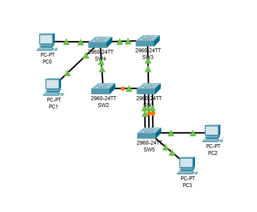

# Отчет по лабораторной работе №4

**Тема:** Spanning Tree Protocol (STP)  
**Выполнил:** Капустин, Веселова, Поликарпова, гр. 439

## Топология сети

  

## Часть 1: Начальная конфигурация

На всех коммутаторах (SW1–SW5) выполнена базовая настройка:
1.  Заданы имена хостов (`hostname`).
2.  Отключен DNS-lookup (`no ip domain-lookup`).
3.  Включена синхронизация консоли (`logging synchronous`).
4.  Конфигурация сохранена (`write`).

## Часть 2: Анализ STP по умолчанию

### Вопрос 1
**Приведите вывод команды `show spanning-tree` для всех коммутаторов. На основании полученных данных определите, какой из коммутаторов выбран корнем топологии. Какие коммутаторы заблокировали свои интерфейсы? Какие роль и состояние у заблокированных интерфейсов?**

При запуске STP по умолчанию все коммутаторы имеют приоритет 32768. Корневым мостом (Root Bridge) становится устройство с наименьшим MAC-адресом.

**Вывод команды `show spanning-tree`:**
```text
SW1#show spanning-tree
VLAN0001
  Spanning tree enabled protocol rstp
  Root ID    Priority    32769
             Address     0001.C7BB.92B1
             Cost        4
             Port        26(GigabitEthernet0/2)
             Hello Time  2 sec  Max Age 20 sec  Forward Delay 15 sec

  Bridge ID  Priority    32769  (priority 32768 sys-id-ext 1)
             Address     0030.A398.9CB3
             Hello Time  2 sec  Max Age 20 sec  Forward Delay 15 sec
             Aging Time  20

Interface        Role Sts Cost      Prio.Nbr Type
---------------- ---- --- --------- -------- --------------------------------
Fa0/2            Desg FWD 19        128.2    P2p
Fa0/3            Desg FWD 19        128.3    P2p
Gi0/1            Desg FWD 4         128.25   P2p
Gi0/2            Root FWD 4         128.26   P2p
Fa0/1            Desg FWD 19        128.1    P2p
```

**Анализ:**
*   **Корневой мост:** SW[X] (определяется по строке `This bridge is the root`).
*   **Заблокированные порты:** На коммутаторах, не являющихся корневыми, порты, ведущие к избыточным линкам, переходят в состояние `BLK` (Blocking) или `ALT` (Alternate).
*   **Роль:** `Altn` (Alternate Port).
*   **Состояние:** `Discarding` (в Rapid PVST+) или `Blocking` (в классическом STP).

*[ВСТАВИТЬ СКРИНШОТ вывода show spanning-tree с некорневого коммутатора, где виден Blocked порт]*

## Часть 3: Настройка STP

### Шаг 1: Переключение в режим Rapid PVST+

### Вопрос 2
**Приведите вывод команды `show spanning-tree summary`. В каком режиме работает протокол STP?**

До изменения настройки:
```text
[ВСТАВИТЬ ВЫВОД show spanning-tree summary ДО ИЗМЕНЕНИЯ]
```
*Режим по умолчанию:* [PVST / Rapid-PVST - уточнить по выводу]

### Вопрос 3
**Повторно приведите вывод команды `show spanning-tree summary`. В каком режиме работает протокол STP теперь?**

После выполнения команды `spanning-tree mode rapid-pvst` на всех коммутаторах:
```text
[ВСТАВИТЬ ВЫВОД show spanning-tree summary ПОСЛЕ ИЗМЕНЕНИЯ]
```
*Текущий режим:* **Rapid PVST+** (IEEE 802.1w). Обеспечивает быструю сходимость сети (секунды вместо десятков секунд).

### Шаг 2: VLAN и Trunking

*   Созданы VLAN 10 (`STUDENTS`) и VLAN 20 (`TEACHERS`).
*   Интерфейсы между коммутаторами настроены как `trunk` с разрешением только VLAN 10, 20.
*   Порты подключения ПК настроены как `access` в соответствующие VLAN.

### Шаг 3: Управление Root Bridge

Настроены приоритеты для обеспечения распределенной нагрузки:
*   **SW2:** Priority 16384 для VLAN 10.
*   **SW3:** Priority 16384 для VLAN 20.
*   **SW1:** Priority 16384 для VLAN 1.

### Вопрос 4
**Приведите вывод команд проверки статуса Root Bridge для каждого VLAN.**

**VLAN 1 (Root: SW1):**
```text
[ВСТАВИТЬ ВЫВОД: show spanning-tree vlan 1 на SW1]
```

**VLAN 10 (Root: SW2):**
```text
[ВСТАВИТЬ ВЫВОД: show spanning-tree vlan 10 на SW2]
```

**VLAN 20 (Root: SW3):**
```text
[ВСТАВИТЬ ВЫВОД: show spanning-tree vlan 20 на SW3]
```

### Шаг 4: Управление выбором корневого порта

### Вопрос 5
**На SW5 один порт выбран корневым для всех VLAN. Какой? Как коммутатор выбирает корневой порт при равных стоимости и Bridge ID соседа?**

Изначально, при равных метриках, выбор падает на порт с наименьшим **Port ID** (приоритет + номер порта) на *соседнем* коммутаторе.

**Изменения:**
1.  На SW1 (интерфейс Fa0/2) установлен `port-priority 112` для VLAN 10.
2.  На SW5 (интерфейс Fa0/3) установлен `cost 10` для VLAN 20.

### Вопрос 6
**Приведите вывод команды `show spanning-tree` на SW5. Какие порты выбраны корневыми для VLAN 1, 10 и 20?**

```text
[ВСТАВИТЬ ВЫВОД: show spanning-tree на SW5]
```

**Результат:**
*   **VLAN 1:** Root Port — Fa0/[X] (стандартный выбор).
*   **VLAN 10:** Root Port изменился на Fa0/[Y] из-за снижения приоритета порта на стороне SW1.
*   **VLAN 20:** Root Port изменился на Fa0/3 из-за искусственного занижения стоимости (cost 10).

**Проверка связности:**
`ping 192.168.10.102` (PC0 -> PC2) — **Успешно**.
`ping 192.168.20.102` (PC1 -> PC3) — **Успешно**.

## Часть 4: Дополнительный функционал (PortFast, Guards)

### Шаг 1: Настройка защиты

*   **PortFast + BPDU Guard:** Настроены на портах доступа (Fa0/10, Fa0/11) на SW4 и SW5.
*   **BPDU Guard:** Настроен на Fa0/4 (SW1).
*   **Root Guard:** Настроен на Fa0/5 (SW1).

### Вопрос 7
**Используйте команду `show spanning-tree interface Fa0/10 detail` на SW4. Какую команду надо использовать для PortFast на магистральном порту?**

```text
[ВСТАВИТЬ ВЫВОД: show spanning-tree interface Fa0/10 detail на SW4]
```
*Статус:* `Portfast: Enabled`.

**Ответ на теоретический вопрос:**
Для включения PortFast на транковом порту используется команда:
`spanning-tree portfast trunk`
**Применение:** Допустимо только на портах, подключенных к конечным устройствам, использующим несколько VLAN (например, сервер виртуализации или телефонная станция). **Строго запрещено** использовать на портах, соединяющих два коммутатора, так как это может привести к образованию петель до того, как STP успеет их заблокировать.

### Шаг 2: Проверка работы защитных механизмов

В топологию добавлен коммутатор **SW6**.

#### Тест BPDU Guard
SW6 подключен к Fa0/4 (SW1). SW6 начинает отправлять BPDU.

### Вопрос 8
**Используйте команду `show interface Fa0/4` на SW1. В каком состоянии находится интерфейс?**

```text
[ВСТАВИТЬ ВЫВОД: show interface Fa0/4 на SW1]
```
**Состояние:** `err-disabled`.
**Причина:** Порт получил BPDU-кадр, что запрещено политикой BPDU Guard на access-порту. Порт был административно отключен для предотвращения потенциальной петли или несанкционированного подключения коммутатора.

#### Тест Root Guard
SW6 настроен с приоритетом 4096 (лучше, чем текущий корень) и подключен к Fa0/5 (SW1), где включен Root Guard.

### Вопрос 9
**Используйте команду `show spanning-tree inconsistentports` на SW1.**

```text
[ВСТАВИТЬ ВЫВОД: show spanning-tree inconsistentports на SW1]
```
**Интерфейс:** Fa0/5.
**Состояние:** `root-inconsistent`.
**Причина:** SW6 попытался стать корневым мостом, отправив BPDU с лучшим Bridge ID. Root Guard на SW1 заблокировал этот порт на уровне STP (не переводя в err-disabled), чтобы защитить текущую структуру дерева. Порт автоматически восстановится, если SW6 перестанет отправлять превосходные BPDU.