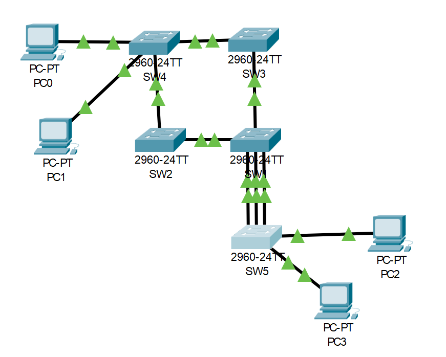

# Отчет по лабораторной работе №4

**Тема:** Spanning Tree Protocol (STP)  
**Выполнил:** Капустин, Веселова, Поликарпова, гр. 439

## Топология сети

  

## Начальная конфигурация

На всех коммутаторах (SW1–SW5) выполнена базовая настройка:
1.  Заданы имена хостов (`hostname`).
2.  Отключен DNS-lookup (`no ip domain-lookup`).
3.  Включена синхронизация консоли (`logging synchronous`).
4.  Конфигурация сохранена (`write`).

### Вопрос 1
При запуске STP по умолчанию все коммутаторы имеют приоритет 32768. Корневым мостом (Root Bridge) становится устройство с наименьшим MAC-адресом.

**Вывод команды `show spanning-tree` на всех коммутаторах:**
```text
SW1#show spanning-tree
VLAN0001
  Spanning tree enabled protocol rstp
  Root ID    Priority    32769
             Address     0001.C7BB.92B1
             Cost        4
             Port        26(GigabitEthernet0/2)
             Hello Time  2 sec  Max Age 20 sec  Forward Delay 15 sec

  Bridge ID  Priority    32769  (priority 32768 sys-id-ext 1)
             Address     0030.A398.9CB3
             Hello Time  2 sec  Max Age 20 sec  Forward Delay 15 sec
             Aging Time  20

Interface        Role Sts Cost      Prio.Nbr Type
---------------- ---- --- --------- -------- --------------------------------
Fa0/2            Desg FWD 19        128.2    P2p
Fa0/3            Desg FWD 19        128.3    P2p
Gi0/1            Desg FWD 4         128.25   P2p
Gi0/2            Root FWD 4         128.26   P2p
Fa0/1            Desg FWD 19        128.1    P2p

SW2#show spanning-tree
VLAN0001
  Spanning tree enabled protocol rstp
  Root ID    Priority    32769
             Address     0001.C7BB.92B1
             Cost        8
             Port        26(GigabitEthernet0/2)
             Hello Time  2 sec  Max Age 20 sec  Forward Delay 15 sec

  Bridge ID  Priority    32769  (priority 32768 sys-id-ext 1)
             Address     0030.F253.E598
             Hello Time  2 sec  Max Age 20 sec  Forward Delay 15 sec
             Aging Time  20

Interface        Role Sts Cost      Prio.Nbr Type
---------------- ---- --- --------- -------- --------------------------------
Gi0/2            Root FWD 4         128.26   P2p
Gi0/1            Altn BLK 4         128.25   P2p

SW3#show spanning-tree
VLAN0001
  Spanning tree enabled protocol rstp
  Root ID    Priority    32769
             Address     0001.C7BB.92B1
             This bridge is the root
             Hello Time  2 sec  Max Age 20 sec  Forward Delay 15 sec

  Bridge ID  Priority    32769  (priority 32768 sys-id-ext 1)
             Address     0001.C7BB.92B1
             Hello Time  2 sec  Max Age 20 sec  Forward Delay 15 sec
             Aging Time  20

Interface        Role Sts Cost      Prio.Nbr Type
---------------- ---- --- --------- -------- --------------------------------
Gi0/1            Desg FWD 4         128.25   P2p
Gi0/2            Desg FWD 4         128.26   P2p

SW4#show spanning-tree
VLAN0001
  Spanning tree enabled protocol rstp
  Root ID    Priority    32769
             Address     0001.C7BB.92B1
             Cost        4
             Port        26(GigabitEthernet0/2)
             Hello Time  2 sec  Max Age 20 sec  Forward Delay 15 sec

  Bridge ID  Priority    32769  (priority 32768 sys-id-ext 1)
             Address     0004.9AD2.75CD
             Hello Time  2 sec  Max Age 20 sec  Forward Delay 15 sec
             Aging Time  20

Interface        Role Sts Cost      Prio.Nbr Type
---------------- ---- --- --------- -------- --------------------------------
Fa0/10           Desg FWD 19        128.10   P2p
Fa0/11           Desg FWD 19        128.11   P2p
Gi0/2            Root FWD 4         128.26   P2p
Gi0/1            Desg FWD 4         128.25   P2p

SW5#show spanning-tree
VLAN0001
  Spanning tree enabled protocol rstp
  Root ID    Priority    32769
             Address     0001.C7BB.92B1
             Cost        23
             Port        1(FastEthernet0/1)
             Hello Time  2 sec  Max Age 20 sec  Forward Delay 15 sec

  Bridge ID  Priority    32769  (priority 32768 sys-id-ext 1)
             Address     0010.1146.939D
             Hello Time  2 sec  Max Age 20 sec  Forward Delay 15 sec
             Aging Time  20

Interface        Role Sts Cost      Prio.Nbr Type
---------------- ---- --- --------- -------- --------------------------------
Fa0/1            Root FWD 19        128.1    P2p
Fa0/2            Altn BLK 19        128.2    P2p
Fa0/3            Altn BLK 19        128.3    P2p
Fa0/10           Desg FWD 19        128.10   P2p
Fa0/11           Desg FWD 19        128.11   P2p
```

### Вопрос 2
До изменения настройки:
```text
SW5#show spanning-tree summary
Switch is in pvst mode
Root bridge for:
Extended system ID           is enabled
Portfast Default             is disabled
PortFast BPDU Guard Default  is disabled
Portfast BPDU Filter Default is disabled
Loopguard Default            is disabled
EtherChannel misconfig guard is disabled
UplinkFast                   is disabled
BackboneFast                 is disabled
Configured Pathcost method used is short

Name                   Blocking Listening Learning Forwarding STP Active
---------------------- -------- --------- -------- ---------- ----------
VLAN0001                     2         1        0          2          5

---------------------- -------- --------- -------- ---------- ----------
1 vlans                      2         1        0          2          5
```
*Режим по умолчанию:* PVST

### Вопрос 3
**Повторно приведите вывод команды `show spanning-tree summary`. В каком режиме работает протокол STP теперь?**

После выполнения команды `spanning-tree mode rapid-pvst` на всех коммутаторах:
```text
SW5#show spanning-tree summary
Switch is in rapid-pvst mode
Root bridge for:
Extended system ID           is enabled
Portfast Default             is disabled
PortFast BPDU Guard Default  is disabled
Portfast BPDU Filter Default is disabled
Loopguard Default            is disabled
EtherChannel misconfig guard is disabled
UplinkFast                   is disabled
BackboneFast                 is disabled
Configured Pathcost method used is short

Name                   Blocking Listening Learning Forwarding STP Active
---------------------- -------- --------- -------- ---------- ----------
VLAN0001                     2         0        0          3          5

---------------------- -------- --------- -------- ---------- ----------
1 vlans                      2         0        0          3          5
```
*Текущий режим:* **Rapid PVST+** (IEEE 802.1w). Обеспечивает быструю сходимость сети (секунды вместо десятков секунд).

### Вопрос 4
**VLAN 1 (Root: SW1):**
```text
SW1#show spanning-tree vlan 1
VLAN0001
  Spanning tree enabled protocol rstp
  Root ID    Priority    16385
             Address     0030.A398.9CB3
             This bridge is the root
             Hello Time  2 sec  Max Age 20 sec  Forward Delay 15 sec

  Bridge ID  Priority    16385  (priority 16384 sys-id-ext 1)
             Address     0030.A398.9CB3
             Hello Time  2 sec  Max Age 20 sec  Forward Delay 15 sec
             Aging Time  20

Interface        Role Sts Cost      Prio.Nbr Type
---------------- ---- --- --------- -------- --------------------------------
Fa0/3            Desg FWD 19        128.3    P2p
Fa0/1            Desg FWD 19        128.1    P2p
Gi0/1            Desg FWD 4         128.25   P2p
Gi0/2            Desg FWD 4         128.26   P2p
Fa0/2            Desg FWD 19        128.2    P2p
```

**VLAN 10 (Root: SW2):**
```text
SW2#show spanning-tree vlan 20
VLAN0020
  Spanning tree enabled protocol rstp
  Root ID    Priority    16404
             Address     0001.C7BB.92B1
             Cost        8
             Port        26(GigabitEthernet0/2)
             Hello Time  2 sec  Max Age 20 sec  Forward Delay 15 sec

  Bridge ID  Priority    32788  (priority 32768 sys-id-ext 20)
             Address     0030.F253.E598
             Hello Time  2 sec  Max Age 20 sec  Forward Delay 15 sec
             Aging Time  20

Interface        Role Sts Cost      Prio.Nbr Type
---------------- ---- --- --------- -------- --------------------------------
Gi0/2            Root FWD 4         128.26   P2p
Gi0/1            Altn BLK 4         128.25   P2p
```

**VLAN 20 (Root: SW3):**
```text
SW3#show spanning-tree vlan 20
VLAN0020
  Spanning tree enabled protocol rstp
  Root ID    Priority    16404
             Address     0001.C7BB.92B1
             This bridge is the root
             Hello Time  2 sec  Max Age 20 sec  Forward Delay 15 sec

  Bridge ID  Priority    16404  (priority 16384 sys-id-ext 20)
             Address     0001.C7BB.92B1
             Hello Time  2 sec  Max Age 20 sec  Forward Delay 15 sec
             Aging Time  20

Interface        Role Sts Cost      Prio.Nbr Type
---------------- ---- --- --------- -------- --------------------------------
Gi0/1            Desg FWD 4         128.25   P2p
Gi0/2            Desg FWD 4         128.26   P2p
```

### Вопрос 5
Изначально, при равных метриках, выбор падает на порт с наименьшим **Port ID** (приоритет + номер порта) на *соседнем* коммутаторе.

**Изменения:**
1.  На SW1 (интерфейс Fa0/2) установлен `port-priority 112` для VLAN 10.
2.  На SW5 (интерфейс Fa0/3) установлен `cost 10` для VLAN 20.

### Вопрос 6
```text
SW5#show spanning-tree 
VLAN0001
  Spanning tree enabled protocol ieee
  Root ID    Priority    16385
             Address     0030.A398.9CB3
             Cost        19
             Port        1(FastEthernet0/1)
             Hello Time  2 sec  Max Age 20 sec  Forward Delay 15 sec

  Bridge ID  Priority    32769  (priority 32768 sys-id-ext 1)
             Address     0010.1146.939D
             Hello Time  2 sec  Max Age 20 sec  Forward Delay 15 sec
             Aging Time  20

Interface        Role Sts Cost      Prio.Nbr Type
---------------- ---- --- --------- -------- --------------------------------
Fa0/1            Root FWD 19        128.1    P2p
Fa0/2            Altn BLK 19        128.2    P2p
Fa0/3            Altn BLK 19        128.3    P2p

VLAN0010
  Spanning tree enabled protocol ieee
  Root ID    Priority    16394
             Address     0030.F253.E598
             Cost        31
             Port        1(FastEthernet0/1)
             Hello Time  2 sec  Max Age 20 sec  Forward Delay 15 sec

  Bridge ID  Priority    32778  (priority 32768 sys-id-ext 10)
             Address     0010.1146.939D
             Hello Time  2 sec  Max Age 20 sec  Forward Delay 15 sec
             Aging Time  20

Interface        Role Sts Cost      Prio.Nbr Type
---------------- ---- --- --------- -------- --------------------------------
Fa0/1            Root FWD 19        128.1    P2p
Fa0/2            Altn BLK 19        128.2    P2p
Fa0/3            Altn BLK 19        128.3    P2p
Fa0/10           Desg FWD 19        128.10   P2p

VLAN0020
  Spanning tree enabled protocol ieee
  Root ID    Priority    16404
             Address     0001.C7BB.92B1
             Cost        23
             Port        1(FastEthernet0/1)
             Hello Time  2 sec  Max Age 20 sec  Forward Delay 15 sec

  Bridge ID  Priority    32788  (priority 32768 sys-id-ext 20)
             Address     0010.1146.939D
             Hello Time  2 sec  Max Age 20 sec  Forward Delay 15 sec
             Aging Time  20

Interface        Role Sts Cost      Prio.Nbr Type
---------------- ---- --- --------- -------- --------------------------------
Fa0/1            Root FWD 19        128.1    P2p
Fa0/2            Altn BLK 19        128.2    P2p
Fa0/3            Altn BLK 19        128.3    P2p
Fa0/11           Desg FWD 19        128.11   P2p
```

**Проверка связности:**
`ping 192.168.10.102` (PC0 -> PC2) — **Успешно**.
`ping 192.168.20.102` (PC1 -> PC3) — **Успешно**.

### Вопрос 7
```text
Port 10 (FastEthernet0/10) of VLAN0010 is designated forwarding
  Port path cost 19, Port priority 128, Port Identifier 128.10
  Designated root has priority 16394, address 0030.F253.E598
  Designated bridge has priority 32778, address 0004.9AD2.75CD
  Designated port id is 128.10, designated path cost 19
  Timers: message age 16, forward delay 0, hold 0
  Number of transitions to forwarding state: 1
  The port is in the portfast mode
  Link type is point-to-point by default
```
*Статус:* `The port is in the portfast mode`.

**Ответ на теоретический вопрос:**
Для включения PortFast на транковом порту используется команда:
`spanning-tree portfast trunk`
**Применение:** Допустимо только на портах, подключенных к конечным устройствам, использующим несколько VLAN (например, сервер виртуализации или телефонная станция). **Строго запрещено** использовать на портах, соединяющих два коммутатора, так как это может привести к образованию петель до того, как STP успеет их заблокировать.

### Вопрос 8
```text
SW1#show interface FastEthernet0/4
FastEthernet0/4 is down, line protocol is down (err-disabled)
  Hardware is Lance, address is 0006.2a2c.2204 (bia 0006.2a2c.2204)
 BW 100000 Kbit, DLY 1000 usec,
     reliability 255/255, txload 1/255, rxload 1/255
  Encapsulation ARPA, loopback not set
  Keepalive set (10 sec)
  Full-duplex, 100Mb/s
  input flow-control is off, output flow-control is off
  ARP type: ARPA, ARP Timeout 04:00:00
  Last input 00:00:08, output 00:00:05, output hang never
  Last clearing of "show interface" counters never
  Input queue: 0/75/0/0 (size/max/drops/flushes); Total output drops: 0
  Queueing strategy: fifo
  Output queue :0/40 (size/max)
  5 minute input rate 0 bits/sec, 0 packets/sec
  5 minute output rate 0 bits/sec, 0 packets/sec
     956 packets input, 193351 bytes, 0 no buffer
     Received 956 broadcasts, 0 runts, 0 giants, 0 throttles
     0 input errors, 0 CRC, 0 frame, 0 overrun, 0 ignored, 0 abort
     0 watchdog, 0 multicast, 0 pause input
     0 input packets with dribble condition detected
     2357 packets output, 263570 bytes, 0 underruns
     0 output errors, 0 collisions, 10 interface resets
     0 babbles, 0 late collision, 0 deferred
     0 lost carrier, 0 no carrier
     0 output buffer failures, 0 output buffers swapped out
```
**Состояние:** `err-disabled`.
**Причина:** Порт получил BPDU-кадр, что запрещено политикой BPDU Guard на access-порту. Порт был административно отключен для предотвращения потенциальной петли или несанкционированного подключения коммутатора.

### Вопрос 9
```text
SW1#show spanning-tree inconsistentports
Name                 Interface            Inconsistency
-------------------- -------------------- ------------------
VLAN0001             FastEthernet0/5      Root Inconsistent

Number of inconsistent ports (segments) in the system : 1
```
**Интерфейс:** Fa0/5.
**Состояние:** `root-inconsistent`.
**Причина:** SW6 попытался стать корневым мостом, отправив BPDU с лучшим Bridge ID. Root Guard на SW1 заблокировал этот порт на уровне STP (не переводя в err-disabled), чтобы защитить текущую структуру дерева. Порт автоматически восстановится, если SW6 перестанет отправлять превосходные BPDU.